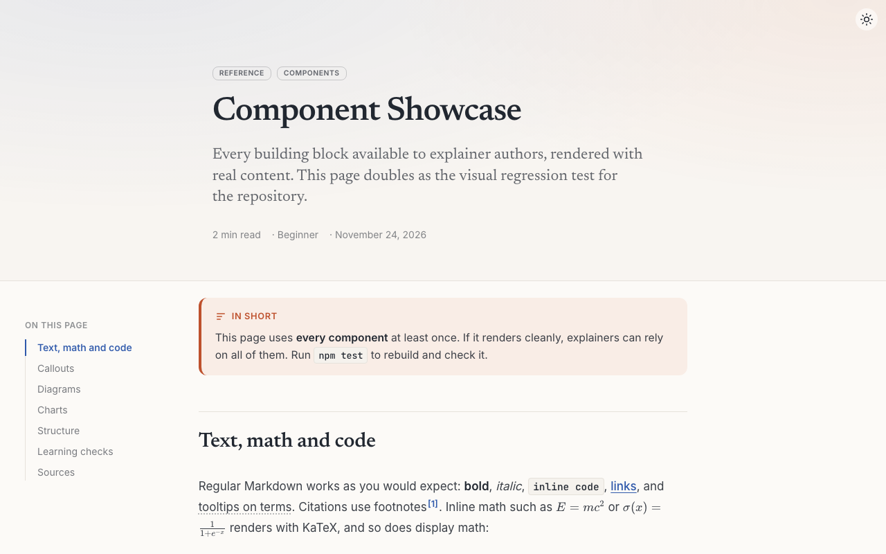
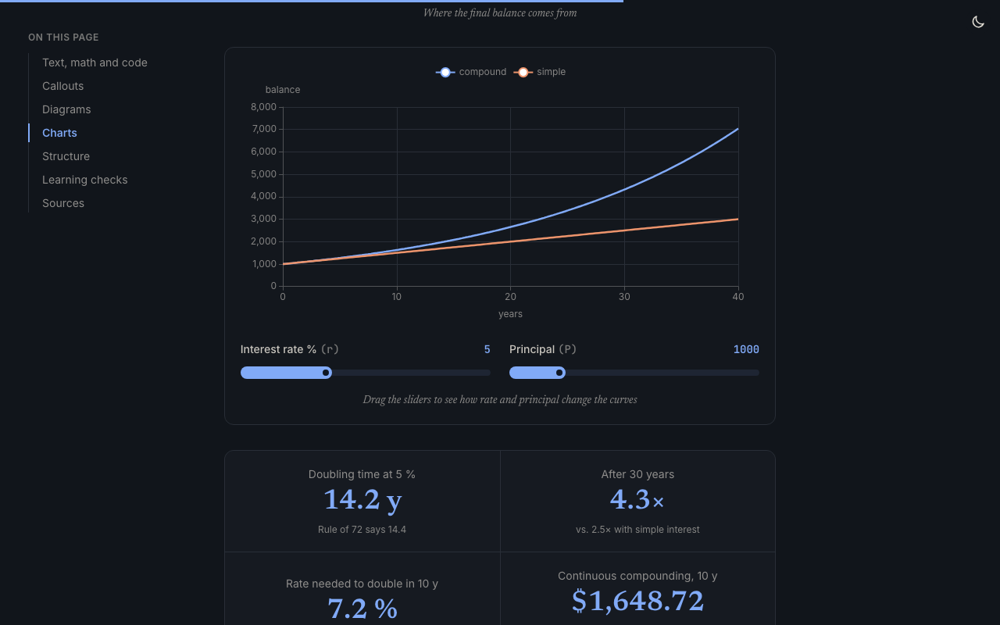
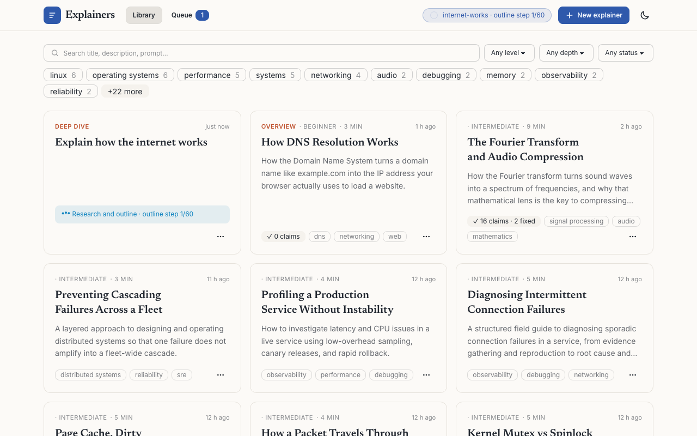
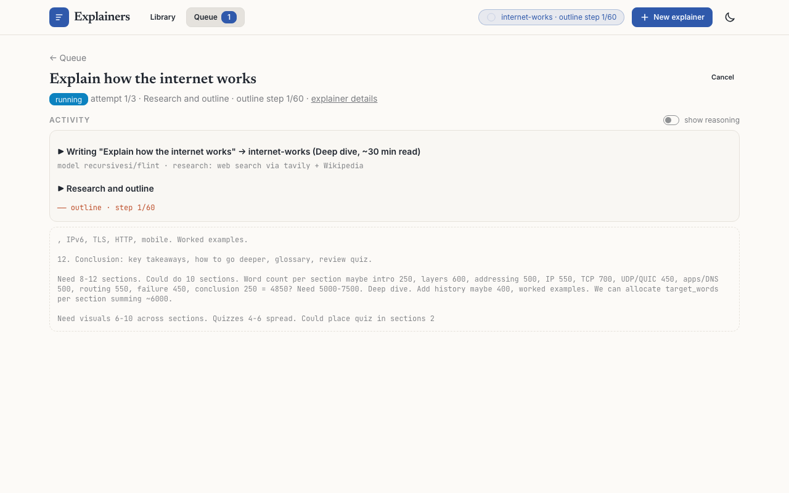
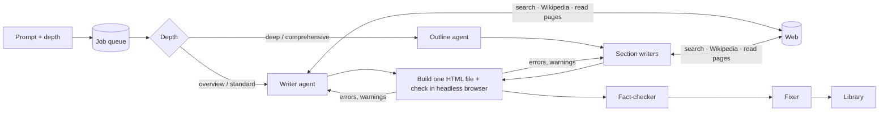

# explainer

**Turn a one-line question into a researched, fact-checked, interactive explainer page, written by an LLM you run yourself.**

Type _"Explain how DNS resolution works"_ into the web app (or the terminal), pick how deep you want to go (a 5-minute overview up to an hour-long deep dive), and some time later you have a polished page: long-form text with diagrams, charts, formulas, interactive plots with sliders, quizzes and flashcards, with its facts checked against web sources and cited. Every explainer is also a **single self-contained HTML file** that works offline and can be downloaded or shared.

|                                                                          |                                                                                   |
| ------------------------------------------------------------------------ | --------------------------------------------------------------------------------- |
|       |  |
|  |                              |

## Why

Chat answers are short, scroll away, and you can't check them. A good explainer is structured, visual, interactive and verifiable, but it takes hours to make. This project gives LLM agents a **content-only job** (Markdown plus a catalogue of tested components) and **feedback loops**:

- research the facts before writing;
- build the page and check it in a real browser, then fix what's broken;
- have an independent fact-checker verify the claims, then fix those too.

The model never writes HTML or CSS, so every page looks consistent. A broken diagram, invented URL or unsupported claim is caught before you see it.

It's designed for **local models** (LM Studio, Ollama, llama.cpp, vLLM, or any OpenAI-compatible endpoint), so your prompts and data stay on your machines. Hosted OpenAI-compatible APIs work too.

## Features

- **Web app**: submit prompts (one at a time or a batch, one per line) and choose a depth. Then:
  - follow each job live: research, writing, checks, fact-check;
  - browse a library you can filter by tag, level, depth and status;
  - revise, re-fact-check, regenerate or delete explainers.

  It works on phones too.

- **Job queue**: exactly one job runs at a time, however many tabs or batches you submit. Jobs survive restarts, failures are retried with growing delays, and one failure never stops the rest of a batch.
- **Depth control**: _Overview_ (~5 min), _Standard_ (~15 min), _Deep dive_ (~30 min), _Comprehensive_ (~60 min). Long explainers are researched and outlined first, then written section by section. Each section writer sees the outline, a shared glossary and summaries of earlier sections, so the length isn't limited by the model's context window.
- **Research**: web search (SearXNG and/or Tavily), Wikipedia, and reading web pages and PDFs. The agent only reads the passages relevant to the fact it's checking. Every cited URL must have come up during research.
- **Fact-checking**: a fresh agent verifies the important claims and citations against sources; a fixer agent corrects what's wrong. The report is kept with the explainer.
- **Notifications** via [ntfy](https://ntfy.sh) when explainers are ready, need attention, or a batch finishes.
- **Rebuild**: change the design or components, then re-render every explainer from its source. No LLM is needed.
- **Guard rails** against accidental damage: generated MDX may only contain literal values (no code runs at build time), and pages served by the app are sandboxed.

## What an explainer contains

- **Text and structure**: typography for long reads, a table of contents that tracks your position, a reading progress bar, and light and dark themes.
- **Visuals**: Mermaid diagrams (flowcharts, sequences, state machines, mind maps…), ECharts charts, KaTeX math, and syntax-highlighted code.
- **Interactive pieces**: function plots with sliders, step-by-step walkthroughs, tabs, quizzes, collapsible "think first" answers, flashcards, and hover definitions.
- **Sources**: numbered footnote citations collected in a _Sources_ section.

## How it works



1. **Plan and research.** The agent lists the specific facts it needs (numbers, dates, names, how real systems work), searches for them and reads the most authoritative pages. For long explainers, an outline agent first designs the sections, glossary and visuals, and gathers sources for each section.
2. **Write.** The explainer is written as MDX (Markdown plus components), with sources cited as footnotes. Long explainers are written one section at a time.
3. **Build and check.** After every write, [Astro](https://astro.build) renders the page with the component library ([Tailwind CSS](https://tailwindcss.com) + [daisyUI](https://daisyui.com), Mermaid, ECharts, KaTeX) and packs it into one HTML file. [Playwright](https://playwright.dev) then opens it at desktop and phone sizes and in dark mode and looks for:
   - JavaScript errors;
   - broken diagrams or charts;
   - math errors;
   - overflowing layout;
   - network requests (the page must be fully self-contained);
   - missing or invalid citations;
   - a length that doesn't match the requested depth.

   The agent fixes everything it reports.

4. **Fact-check and fix.** A separate agent with a fresh context checks the claims and citations (section by section for long explainers). A fixer agent applies the corrections, and the result is checked again.

## Quick start

**Requirements**

- An OpenAI-compatible chat endpoint with a model that supports **tool calling**. A context window of at least 32k tokens is recommended. Larger models write noticeably better explainers.
- Optional, for web research: a [Tavily](https://tavily.com) API key (its free tier is enough for occasional use) **or** a [SearXNG](https://docs.searxng.org) instance. Wikipedia and page reading work without either.
- To run from source: Node.js **23.6 or newer**. To self-host: Docker or Podman.

### Run from source

```bash
git clone <this repo> explainer && cd explainer
npm install          # also downloads a headless Chromium for the render checks
npm test             # builds and checks the component showcase, which proves the toolchain works
npm run build:app    # builds the web UI
```

Point `explainer.config.json` at your model (see [Configuration](#configuration)), then either start the service:

```bash
export TAVILY_API_KEY=tvly-…   # or configure SearXNG, or set research.provider to "none"
npm start                      # → http://localhost:8080
```

…or use the command line:

```bash
npm run explain -- "Explain how public-key cryptography works and why HTTPS depends on it" --depth deep
```

### Self-host with a container

Every push to `main` builds an image and publishes it to the GitHub Container Registry as `ghcr.io/<owner>/<repo>:latest` (see [`.github/workflows/container.yml`](.github/workflows/container.yml)). The image build also runs the render test inside the image. The example [`deploy/compose.yaml`](deploy/compose.yaml) runs the service together with a private SearXNG instance:

```bash
cp -r deploy ~/explainer && cd ~/explainer
# edit compose.yaml: image owner, inference endpoint, model, keys, PUBLIC_URL, ntfy topic
# edit searxng/settings.yml: set a random secret_key
docker compose up -d          # or: podman compose up -d
```

- **Permissions.** The container runs as user `node` (uid 1000), so make the data folder writable for it: `mkdir data && sudo chown 1000:1000 data`.
- **Data.** All data lives in the `/data` volume: `explainers/`, the job database `explainer.db`, and an optional `config.json`. Back it up by copying the folder.
- **Configuration.** Use environment variables (below) or put a full `config.json` in `/data`.
- **Access.** The service has no login; it's meant for a private network. Keep it on your LAN or reach it over a VPN. [Tailscale](https://tailscale.com) is the simplest option: install it on the server and your phone, then open `http://<server-name>:8080`, or use `tailscale serve` for HTTPS. Don't expose it to the internet without putting authentication in front of it.
- **Inference endpoint.** It must be reachable from the container, e.g. LM Studio on your laptop with "serve on local network" enabled.

## Usage

### Web app

| View                         | What you can do                                                                                                                      |
| ---------------------------- | ------------------------------------------------------------------------------------------------------------------------------------ |
| **Library** (`/`)            | Search, filter by tag, level, depth and status, and open explainers. Cards show progress while an explainer is being generated.      |
| **New** (`#/new`)            | Enter one prompt, or a batch (one per line), choose a depth, and turn fact-checking on or off.                                       |
| **Queue** (`#/jobs`)         | Running, queued and finished jobs; cancel or retry them. Retries happen automatically with growing delays (1, 5, 15 min…).           |
| **Job** (`#/jobs/<id>`)      | Live activity: research queries, pages read, drafts, check results, fact-check findings, and the model's reasoning if you want it.   |
| **Explainer** (`#/x/<slug>`) | Metadata, fact-check report, sources read. Actions: revise with an instruction, fact-check again, regenerate HTML, download, delete. |

Explainer pages are served at `/e/<slug>/`.

### Command line

```bash
npm run explain -- "<prompt>" [--depth overview|standard|deep|comprehensive] [--no-fact-check]
npm run explain -- --revise <slug> "<what to change>"
npm run explain -- --fact-check <slug>         # fact-check (and fix) an existing explainer
npm run rebuild -- --all                       # re-render every explainer from its MDX (no LLM)
npm run rebuild -- <slug>
npm run build -- <slug> --open                 # rebuild one page after editing index.mdx by hand
npm run check -- <slug>                        # render-check one page
```

More `explain` options: `--slug <name>`, `--model <id>`, `--effort none|low|medium|high`, `--max-steps <n>`, `--no-open`. Press Ctrl-C to cancel. A deep or comprehensive run can be resumed by running it again with the same `--slug` and prompt; finished sections are kept.

### Writing by hand or with another coding agent

The content rules and component reference are in [`agent/prompts/authoring-guide.md`](agent/prompts/authoring-guide.md). You can write `data/explainers/<slug>/index.mdx` yourself, or ask Claude Code, Codex, Cursor and similar to "write an explainer about X following agent/prompts/authoring-guide.md". Then build and check it.

### Depths

| Depth           | Reading | Words         | How it's written                                 |
| --------------- | ------- | ------------- | ------------------------------------------------ |
| `overview`      | ~5 min  | 700–1,300     | single pass: the core idea, one example          |
| `standard`      | ~15 min | 2,200–3,500   | single pass: mechanism, examples, misconceptions |
| `deep`          | ~30 min | 5,000–7,500   | outline + 8–12 sections, each by a fresh agent   |
| `comprehensive` | ~60 min | 10,000–14,000 | outline + 12–18 sections, each by a fresh agent  |

Writing time depends on your model and hardware. With a ~30B model on a laptop, a standard explainer takes roughly 15–30 minutes including research and fact-check; a comprehensive one can take several hours. That's what batches running overnight are for.

## Configuration

Settings come from the first of these that exists:

1. `EXPLAINER_CONFIG` (a path);
2. `<data dir>/config.json`;
3. the repository's `explainer.config.json`.

Environment variables override the file. The real file is plain JSON; the comments below are explanatory only.

```jsonc
{
  "llm": {
    "baseUrl": "http://localhost:1234/v1", // OpenAI-compatible endpoint
    "apiKey": "not-needed", // sent as a Bearer token; local servers usually ignore it
    "model": "qwen/qwen3.8-27b", // id as listed by GET <baseUrl>/models
    "reasoningEffort": "medium", // "none" | "low" | "medium" | "high" | null (don't send)
    "temperature": 0.6, // null = server default
    "maxTokens": null, // per response; null = server default
    "requestTimeoutSeconds": 1800,
    "extraBody": {}, // merged into every request, e.g. {"top_p": 0.95}
  },
  "agent": {
    "maxSteps": 60, // max model turns per agent (writer, each section, …)
    "showReasoning": true, // CLI: stream the model's thinking (dimmed)
    "defaultDepth": "standard",
  },
  "factCheck": {
    "enabled": true,
    "model": null, // a different model gives a more independent check; null = same model
    "maxSteps": 40,
  },
  "output": { "openInBrowser": true }, // CLI only
  "server": {
    "port": 8080,
    "publicUrl": null, // e.g. "http://thinkcentre.lan:8080", used for links in notifications
    "jobRetries": 2, // automatic retries per job (delays 1, 5, 15, 30 min)
  },
  "notifications": {
    "ntfy": { "url": null, "topic": null, "token": null }, // e.g. "https://ntfy.sh" + a hard-to-guess topic
    "eachJob": true, // notify per explainer (batch summaries and failures are always sent)
  },
  "research": {
    "provider": "tavily", // "searxng" | "tavily" | "none" | a fallback chain like ["searxng", "tavily"]
    "wikipedia": true,
    "wikipediaLanguage": "en",
    "searxng": {
      "url": "http://localhost:8080",
      "engines": null,
      "categories": null,
      "language": "en",
    },
    "tavily": { "apiKey": null, "searchDepth": "basic" }, // apiKey null → env TAVILY_API_KEY
    "jina": { "apiKey": null }, // optional; env JINA_API_KEY
    "searchLimits": {
      "overview": 12,
      "standard": 25,
      "deep": 50,
      "comprehensive": 80,
    }, // max paid web searches per explainer
    "maxResults": 8,
    "preferredDomains": [
      "wikipedia.org",
      "developer.mozilla.org",
      "ietf.org",
      "…",
    ], // ranked first
    "blockedDomains": ["pinterest.com", "quora.com"],
    "fetch": { "maxChars": 8000, "timeoutSeconds": 20, "fallback": "jina" }, // fallback: "none" | "jina" | "tavily"
  },
}
```

**Environment variables**

| Variable                                                     | Overrides                                                   |
| ------------------------------------------------------------ | ----------------------------------------------------------- |
| `EXPLAINER_BASE_URL`, `EXPLAINER_MODEL`, `EXPLAINER_API_KEY` | `llm.*`                                                     |
| `EXPLAINER_SEARCH_PROVIDER`                                  | `research.provider` (e.g. `none`, `searxng,tavily`)         |
| `SEARXNG_URL`, `TAVILY_API_KEY`, `JINA_API_KEY`              | research backends                                           |
| `PORT`, `PUBLIC_URL`                                         | `server.*`                                                  |
| `NTFY_URL`, `NTFY_TOPIC`, `NTFY_TOKEN`                       | `notifications.ntfy.*`                                      |
| `EXPLAINER_DATA_DIR`                                         | data directory (default `./data`; `/data` in the container) |
| `EXPLAINER_CONFIG`                                           | path of the config file                                     |

**Reasoning models.** `reasoningEffort` is sent as the standard `reasoning_effort` parameter. If your server controls thinking another way, set it to `null` and use `extraBody`, e.g. `{"chat_template_kwargs": {"enable_thinking": false}}`.

## Web research

| Tool               | What it does                                                                                         | Needs                                               |
| ------------------ | ---------------------------------------------------------------------------------------------------- | --------------------------------------------------- |
| `web_search`       | Web search through the configured provider chain                                                     | Tavily key or a SearXNG instance                    |
| `search_wikipedia` | Searches Wikipedia                                                                                   | nothing                                             |
| `fetch_page`       | Reads a web page or PDF as text. With `focus`, only the passages relevant to the fact being checked. | nothing (the optional fallback uses Jina or Tavily) |

**Choosing a search provider**

- **Tavily** is the easiest. It's built for AI agents and returns query-relevant excerpts; the free tier covers occasional use (an explainer uses roughly 10–30 searches, more for long ones).
- **SearXNG** is self-hosted, private and free. It queries engines such as Google, Bing, DuckDuckGo and Brave on your behalf, so individual engines may rate-limit or temporarily block your instance; enable several. Its JSON API must be enabled in `settings.yml` (`search.formats: [html, json]`; the example in [`deploy/searxng/settings.yml`](deploy/searxng/settings.yml) does this).
- **Both:** `["searxng", "tavily"]` uses SearXNG and falls back to Tavily when it errors or finds nothing.

**Reading pages.** Pages are fetched directly and reduced to their readable text locally (encyclopedias, documentation, standards, university pages, PDFs). Only when a direct fetch fails (JavaScript-only sites, bot protection) is the fallback used: [Jina Reader](https://jina.ai/reader) works without a key at low request rates, and Tavily Extract reuses your Tavily key.

**Cost control.** Paid web searches are capped per explainer by depth (`research.searchLimits`, covering writing and fact-check together), and each agent has a small budget of its own. Repeated or near-identical searches, Wikipedia searches and anything already in the persistent search cache (`data/search-cache.json`, 30 days) are free. An agent that keeps repeating searches loses search access for the rest of its task. With the defaults, a deep explainer uses at most 50 Tavily credits.

**Citations.** Every URL in an explainer must have appeared in search results or been read during research. Anything else is rejected, which stops invented references. Each explainer keeps a `sources.json` ledger, so revisions and fact-checks can reuse its sources.

## Data layout

```
data/                          ← EXPLAINER_DATA_DIR (/data in the container)
  explainer.db                 job queue and activity logs (SQLite)
  config.json                  optional configuration
  explainers/<slug>/
    index.mdx                  the source of truth (editable)
    index.html                 the standalone page
    meta.json                  title, tags, level, depth, status, stats (drives the library)
    sources.json               research ledger
    factcheck.json             last fact-check report
    outline.json, sections/    plan and drafts of long explainers (used to resume)
    agent-log.jsonl            full agent transcript
```

## Customising

- **Look and feel**: both themes ("paper" and "ink"), the fonts and the typography live in [`src/styles/global.css`](src/styles/global.css). Components, charts and diagrams derive their colours from the theme. After changing the design, run `npm test`, then **Regenerate HTML** (or `npm run rebuild -- --all`) to update existing explainers.
- **Writing style and rules**:
  - [`agent/prompts/authoring-guide.md`](agent/prompts/authoring-guide.md): what makes a good explainer, MDX rules and the component reference;
  - `agent/prompts/*.md`: the process for each agent (writer, outline, section, fact-checker, fixer);
  - [`agent/depth.ts`](agent/depth.ts): word counts and structure per depth.
- **New components or research providers**: see [`AGENTS.md`](AGENTS.md), the developer guide.

## Troubleshooting

- **"LLM request failed"**: check that the endpoint is reachable from where the service runs, that `baseUrl` ends in `/v1`, and that `model` matches an id from `GET <baseUrl>/models`. The queue retries failed jobs automatically.
- **The model answers in prose instead of calling tools, or gets stuck**: use a model or chat template with proper tool-calling support. The agents include guards (state-dependent tools, repetition detection, research budgets), but native tool calls work best.
- **Long silent pauses**: some servers only send a tool call once it's complete, so writing a long section can take minutes with no output. The activity log shows a "waiting…" timer; that's expected.
- **Status "needs attention"**: the last check didn't pass, or fact-check findings weren't fully resolved. Open the explainer's details for the report, then revise it or fact-check again.
- **SearXNG returns HTTP 403**: its JSON API isn't enabled.
- **Page size**: about 1 MB of base CSS and fonts; charts add about 1 MB and diagrams about 5 MB. Libraries are only included when a page uses them.
