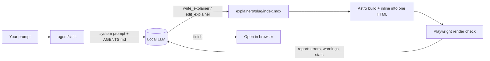

# explainer

Turn a one-line prompt into a polished, interactive, **standalone HTML explainer**, written by a model running on your own machine.

```bash
npm run explain -- "Explain the Fourier transform and its applicability to audio compression"
```

The agent plans and writes an MDX document. Every draft is built with Astro and checked in a headless browser, and the agent fixes whatever the check reports. When the check passes, the finished page opens in your browser. That page is a single `.html` file with nothing to install, no server and no network access needed, and it works offline. It includes:

- long-form typography with light and dark themes, a table of contents with scroll-spy, and a reading progress bar
- KaTeX math and syntax-highlighted code
- Mermaid diagrams, ECharts charts and interactive function plots with sliders
- quizzes, flashcards, step-by-step walkthroughs, tabs, timelines, callouts and tooltips

The model only writes content (Markdown plus a catalogue of pre-built components). It never writes HTML or CSS.

## Requirements

- **Node.js ≥ 23.6** (TypeScript runs natively; no build step for the tooling).
- A local **OpenAI-compatible** inference server (LM Studio, Ollama, llama.cpp `llama-server`, vLLM, …) serving a model that supports **tool calling**. A context window of at least **32k tokens** is recommended: the system prompt is about 4k tokens and a full explainer is 6–12k.

## Setup

```bash
npm install      # also downloads Playwright's headless Chromium
npm test         # builds and render-checks explainers/showcase (uses every component)
```

Then edit `explainer.config.json`:

```jsonc
{
  "llm": {
    "baseUrl": "http://localhost:1235/v1",   // your server's OpenAI-compatible endpoint
    "apiKey": "not-needed",                  // sent as Bearer token; most local servers ignore it
    "model": "qwen/qwen3.8-27b",             // model id as listed by GET /v1/models
    "reasoningEffort": "medium",             // "none" | "low" | "medium" | "high" | null (null = don't send)
    "temperature": 0.6,                      // null = server default
    "maxTokens": null,                       // per response; null = server default
    "requestTimeoutSeconds": 1800,
    "extraBody": {}                          // merged verbatim into every request, e.g. {"top_p": 0.95}
  },
  "agent": {
    "maxSteps": 20,                          // max model turns per run
    "showReasoning": true                    // stream the model's thinking (dimmed) to the terminal
  },
  "output": {
    "openInBrowser": true
  }
}
```

(The real file is plain JSON, without comments.) `reasoningEffort` is sent as the standard `reasoning_effort` parameter. If your server controls thinking differently, set it to `null` and use `extraBody`, e.g. `{"chat_template_kwargs": {"enable_thinking": false}}`.
You can also override settings with environment variables (`EXPLAINER_MODEL`, `EXPLAINER_BASE_URL`, `EXPLAINER_API_KEY`, `EXPLAINER_CONFIG=/path/to/other.json`) or CLI flags.

## Usage

### Generate an explainer

```bash
npm run explain -- "Explain X and its applicability to Y"
```

Output goes to `explainers/<slug>/`:

| File | What |
|---|---|
| `index.mdx` | The content the agent wrote. Yours to edit. |
| `<slug>.html` | The standalone page. Open it, move it or share it. |
| `.check/*.png` | Desktop, mobile and dark-mode screenshots from the last check |
| `agent-log.jsonl` | Full transcript (messages, reasoning, tool calls) for debugging |

Flags:

```
--slug <slug>        output folder name (default: derived from the prompt)
--model <id>         override the configured model
--effort <level>     override reasoningEffort
--max-steps <n>      override agent.maxSteps
--no-open            don't open the browser at the end
```

### Revise an existing explainer

```bash
npm run explain -- --revise fourier-transform-applicability-audio-compression "Add a section on the MDCT and a quiz about windowing"
```

The agent receives the current file and makes targeted edits.

### Edit by hand

Edit `explainers/<slug>/index.mdx` yourself, then:

```bash
npm run build -- <slug> --open   # rebuild the standalone HTML and open it
npm run check -- <slug>          # verify it renders (errors, broken diagrams, overflow…)
npm run dev                      # live-reload dev server with an index of all explainers
```

### Use another coding agent

`AGENTS.md` is a complete authoring guide: workflow, writing guidelines, MDX pitfalls, and every component with examples. Claude Code, Codex, Cursor and similar agents can write explainers in this repo directly. Ask them to "write an explainer about X following AGENTS.md" and they'll use `npm run build` and `npm run check` to verify their work.

## How it works



1. **Agent loop** (`agent/`): a small tool-calling loop over the OpenAI chat-completions API. The system prompt is `agent/system-prompt.md` with `AGENTS.md` inlined. Tools: `write_explainer`, `edit_explainer` (exact search/replace), `read_explainer`, and `finish`. `finish` is refused until the latest check passes.
2. **Build** (`scripts/build.ts`): runs `astro build` for that one explainer. `scripts/lib/inline.ts` then produces a single file: CSS inlined, fonts and images as `data:` URIs, and all JavaScript (including lazily loaded Mermaid and ECharts chunks) re-bundled with esbuild into one inline module.
3. **Check** (`scripts/check.ts`): opens the file in headless Chromium at desktop and mobile widths and in dark mode. It fails on uncaught exceptions, console errors, *any* network request (the page must be self-contained), components that report an error (Mermaid syntax, invalid chart option, broken function), KaTeX parse errors, and empty charts. It warns about horizontal overflow on phones, very short content, missing structure, and no visuals.

Build errors (invalid MDX, unknown component, bad props) come back to the model with file line numbers and actionable messages. Components validate their own props at build time.

## Repository layout

```
explainer.config.json     model / endpoint / agent options
AGENTS.md                 authoring guide (the agent's manual, also for other coding agents)
agent/                    CLI + agent loop (cli.ts, llm.ts, tools.ts, system-prompt.md)
scripts/                  build.ts, check.ts, lib/inline.ts
explainers/<slug>/        one folder per explainer (index.mdx → <slug>.html)
explainers/showcase/      reference page using every component (= the test)
src/components/           the component library (Astro + daisyUI + Tailwind)
src/layouts/Explainer.astro  page shell: header, TOC, theme toggle, progress bar
src/styles/global.css     typography and the light/dark themes ("paper" / "ink")
astro.config.mjs          MDX, KaTeX, Mermaid fences, Shiki, inlining settings
```

## Customising

- **Look and feel**: the colours of both themes and the fonts (Newsreader for headings, Inter for text, JetBrains Mono for code) live in `src/styles/global.css`. Every component reads the theme variables, including charts and diagrams.
- **Writing style**: edit the guidelines in `AGENTS.md` and the process in `agent/system-prompt.md`.
- **New components**: see "For agents maintaining this repository" at the end of `AGENTS.md`. Briefly: add an `.astro` file to `src/components/`, register it in `src/components/index.ts`, document it in `AGENTS.md`, use it in the showcase, then run `npm test`.

## Notes and troubleshooting

- **File size**: a page is about 1 MB of base CSS and fonts. Charts add about 1 MB (ECharts) and diagrams add about 5 MB (Mermaid and its layout engines). Libraries are only included when the page uses them.
- **"LLM request failed"**: check that the server is running, `baseUrl` ends in `/v1`, and the model id matches `GET <baseUrl>/models`.
- **The model replies with text instead of calling tools**: use a model or chat template with proper tool-calling support. The CLI has fallbacks: it saves MDX that's pasted as text, and it parses `<tool_call>` tags that leak into the text. Results are still best with native tool calls.
- **Stopped without passing**: the last successful build is kept. Continue with `--revise <slug> "fix the remaining issues"`, or fix the MDX by hand.
- **Weak or inaccurate content**: everything comes from the local model's own knowledge (there's no web access), so use the largest model you can run. Raising `reasoningEffort` helps with planning and accuracy.
