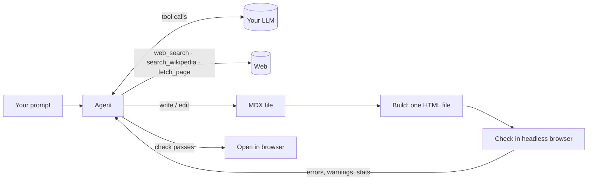

# explainer

**Turn a one-line question into a researched, interactive explainer page, written by an LLM you run yourself.**

```bash
npm run explain -- "Explain the Fourier transform and its applicability to audio compression"
```

A few minutes later you get a polished web page: long-form text with diagrams, charts, formulas, interactive plots with sliders, quizzes and flashcards, with the specific facts checked against web sources and cited. The page is a **single self-contained HTML file**. It works offline, needs no server, and you can keep it, move it or share it.

|                                                                     |                                                                                   |
| ------------------------------------------------------------------- | --------------------------------------------------------------------------------- |
|  |  |

> **Status:** the command-line workflow works today. A self-hosted web service is on the [roadmap](docs/PLAN.md): you'd write prompts in the browser, run batches overnight through a job queue, and browse, filter and delete explainers from an index.

## Why

Chat answers are short, scroll away, and you can't check them. A good explainer is structured, visual, interactive and verifiable, but it takes hours to make. This project gives an LLM agent a **content-only job** (Markdown plus a catalogue of tested components) and a **feedback loop**: research the facts, write, build, check the rendered page in a real browser, fix. The model never writes HTML or CSS, so the output always looks consistent, and a broken diagram or invented URL is caught before you see the page.

It's designed for **local models** (LM Studio, Ollama, llama.cpp, vLLM, or any OpenAI-compatible endpoint), so your prompts and data stay on your machines. Hosted OpenAI-compatible APIs work too.

## What an explainer contains

- **Text and structure**: typography for long reads, a table of contents that tracks your position, a reading progress bar, and light and dark themes.
- **Visuals**: Mermaid diagrams (flowcharts, sequences, state machines, mind maps…), ECharts charts, KaTeX math, and syntax-highlighted code.
- **Interactive pieces**: function plots with sliders, step-by-step walkthroughs, tabs, quizzes, collapsible "think first" answers, flashcards, and hover definitions.
- **Sources**: numbered footnote citations collected in a _Sources_ section. Every cited URL must have come up during the agent's research.

## How it works



1. **Plan and research.** The agent lists the facts it needs to verify (numbers, dates, names, how real systems work). It searches the web and Wikipedia and reads the most authoritative pages, including PDFs. It only reads the passages relevant to each fact, which keeps the model's context small.
2. **Write.** It writes the explainer as MDX (Markdown plus components) and cites sources as footnotes.
3. **Build.** [Astro](https://astro.build) renders the MDX with the component library ([Tailwind CSS](https://tailwindcss.com) + [daisyUI](https://daisyui.com), Mermaid, ECharts, KaTeX). The result is then packed into a single HTML file with everything inlined.
4. **Check.** [Playwright](https://playwright.dev) opens the page at desktop and phone sizes and in dark mode. It reports JavaScript errors, broken diagrams or charts, math errors, overflowing layout, missing structure, and any network request (the page must be fully self-contained). Citations are checked against the URLs actually seen during research.
5. **Fix.** The agent gets the report and fixes problems until the check passes, then finishes.

## Quick start

**Requirements**

- Node.js **23.6 or newer**.
- An OpenAI-compatible chat endpoint with a model that supports **tool calling**. A context window of at least 32k tokens is recommended; more is better for research-heavy topics. Larger models write noticeably better explainers.
- Optional, for web research: a [Tavily](https://tavily.com) API key (its free tier is enough for occasional use) **or** a self-hosted [SearXNG](https://docs.searxng.org) instance. Wikipedia and page reading work without either.

```bash
git clone <this repo> explainer && cd explainer
npm install                  # also downloads a headless Chromium for the render check
npm test                     # builds and checks the component showcase, which proves the toolchain works
```

Point `explainer.config.json` at your model (see [Configuration](#configuration)), then:

```bash
export TAVILY_API_KEY=tvly-…   # or configure SearXNG, or set research.provider to "none"
npm run explain -- "Explain how public-key cryptography works and why HTTPS depends on it"
```

The page opens in your browser when it's done. Everything is stored in `explainers/<slug>/`:

| File              | What                                                                              |
| ----------------- | --------------------------------------------------------------------------------- |
| `index.mdx`       | The explainer source, readable and editable by hand. This is the source of truth. |
| `<slug>.html`     | The standalone page.                                                              |
| `sources.json`    | Every source the agent found or read.                                             |
| `agent-log.jsonl` | The full transcript: messages, reasoning and tool calls.                          |
| `.check/*.png`    | Screenshots from the last render check.                                           |

## Usage

```bash
npm run explain -- "<prompt>"                       # write a new explainer
npm run explain -- --revise <slug> "<what to change>"   # revise an existing one (targeted edits)
npm run build -- <slug> --open                      # rebuild the HTML after editing index.mdx by hand
npm run check -- <slug>                             # render-check an explainer
npm run dev                                         # live preview server with an index of all explainers
```

`explain` options: `--slug <name>` (output folder; derived from the prompt by default), `--model <id>`, `--effort none|low|medium|high`, `--max-steps <n>`, `--no-open`.

**Writing by hand or with another coding agent.** The content rules and component reference are in [`agent/prompts/authoring-guide.md`](agent/prompts/authoring-guide.md). You can write `explainers/<slug>/index.mdx` yourself, or ask Claude Code, Codex, Cursor and similar to "write an explainer about X following agent/prompts/authoring-guide.md", then build and check it.

## Configuration

Everything is in `explainer.config.json`. The real file is plain JSON; the comments below are explanatory only.

```jsonc
{
  "llm": {
    "baseUrl": "http://localhost:1234/v1", // OpenAI-compatible endpoint (LM Studio, Ollama: :11434/v1, llama.cpp, vLLM…)
    "apiKey": "not-needed", // sent as a Bearer token; local servers usually ignore it
    "model": "qwen/qwen3.8-27b", // id as listed by GET <baseUrl>/models
    "reasoningEffort": "medium", // "none" | "low" | "medium" | "high" | null (null = don't send)
    "temperature": 0.6, // null = server default
    "maxTokens": null, // per response; null = server default
    "requestTimeoutSeconds": 1800, // long, because writing a full explainer takes a while
    "extraBody": {}, // merged into every request, e.g. {"top_p": 0.95}
  },
  "agent": {
    "maxSteps": 60, // max model turns per run (research uses many)
    "showReasoning": true, // stream the model's thinking (dimmed) to the terminal
  },
  "output": { "openInBrowser": true },
  "research": {
    "provider": "tavily", // "searxng" | "tavily" | "none" | a fallback chain like ["searxng", "tavily"]
    "wikipedia": true, // search_wikipedia tool (free public API)
    "wikipediaLanguage": "en",
    "searxng": {
      "url": "http://localhost:8080", // your SearXNG instance
      "engines": null, // e.g. "google,bing,duckduckgo,wikipedia"; null = instance defaults
      "categories": null, // e.g. "general,science,it"
      "language": "en",
    },
    "tavily": { "apiKey": null, "searchDepth": "basic" }, // apiKey null → env TAVILY_API_KEY
    "jina": { "apiKey": null }, // optional; env JINA_API_KEY
    "maxResults": 8, // search results shown to the model per query
    "preferredDomains": [
      "wikipedia.org",
      "developer.mozilla.org",
      "ietf.org",
      "…",
    ], // ranked first, marked ★
    "blockedDomains": ["pinterest.com", "quora.com"],
    "fetch": {
      "maxChars": 8000, // page text returned per fetch_page call
      "timeoutSeconds": 20,
      "fallback": "jina", // "none" | "jina" | "tavily": extraction service used only when a direct fetch fails
    },
  },
}
```

Environment overrides: `EXPLAINER_MODEL`, `EXPLAINER_BASE_URL`, `EXPLAINER_API_KEY`, `EXPLAINER_SEARCH_PROVIDER` (e.g. `none`, or `searxng,tavily`), `SEARXNG_URL`, `TAVILY_API_KEY`, `JINA_API_KEY`, and `EXPLAINER_CONFIG` to use another config file.

**Reasoning models.** `reasoningEffort` is sent as the standard `reasoning_effort` parameter. If your server controls thinking another way, set it to `null` and use `extraBody`, e.g. `{"chat_template_kwargs": {"enable_thinking": false}}`.

## Web research

The agent has three research tools:

| Tool               | What it does                                                                                                                                        | Needs                                               |
| ------------------ | --------------------------------------------------------------------------------------------------------------------------------------------------- | --------------------------------------------------- |
| `web_search`       | Web search through the configured provider chain                                                                                                    | Tavily key or a SearXNG instance                    |
| `search_wikipedia` | Searches Wikipedia                                                                                                                                  | nothing                                             |
| `fetch_page`       | Reads a web page or PDF as text. With `focus`, only the passages relevant to what's being checked. Wikipedia pages come through its clean-text API. | nothing (the optional fallback uses Jina or Tavily) |

**Choosing a search provider**

- **Tavily** is the easiest. It's built for AI agents and returns query-relevant excerpts. Its free tier covers occasional use (a thorough explainer uses roughly 10–30 searches).
- **SearXNG** is self-hosted, private and free, with no API key. It aggregates engines such as Google, Bing, DuckDuckGo, Brave and Wikipedia by querying them on your behalf, so individual engines may rate-limit or temporarily block your instance, especially Google. Enable several engines so one failing engine doesn't matter. SearXNG has no MCP server and doesn't need one: the agent calls its JSON API, which you must enable in SearXNG's `settings.yml`:

  ```yaml
  search:
    formats: [html, json]
  ```

- **Both:** `"provider": ["searxng", "tavily"]` uses SearXNG and falls back to Tavily when SearXNG errors or finds nothing.

**Reading pages.** Pages are fetched directly and reduced to their readable text locally, which works for most reference sources (encyclopedias, documentation, standards, university pages, papers as PDF). Only when a direct fetch fails (JavaScript-only sites, bot protection, broken TLS) is the configured fallback used. [Jina Reader](https://jina.ai/reader) works without a key at low request rates; Tavily Extract reuses your Tavily key.

**Citations.** Every URL in an explainer must have appeared in the agent's search results or been read during the run. URLs are compared after normalisation (no `www.`, fragment, tracking parameters or trailing slash). Anything else is rejected and the agent has to research the source or remove it, which stops invented references. Revisions reuse the explainer's `sources.json`, so earlier citations stay valid.

## Customising

- **Look and feel**: both themes ("paper" and "ink"), the fonts and the typography live in [`src/styles/global.css`](src/styles/global.css). Components, charts and diagrams all derive their colours from the theme. Run `npm test` and look at `explainers/showcase/.check/*.png` after changes.
- **Writing style and rules**: [`agent/prompts/authoring-guide.md`](agent/prompts/authoring-guide.md) covers what a good explainer looks like, MDX rules and the component reference. [`agent/prompts/system.md`](agent/prompts/system.md) covers the agent's process: research first, then write, then fix.
- **New components or research providers**: see [`AGENTS.md`](AGENTS.md), the developer guide.

## Troubleshooting

- **"LLM request failed"**: check that the server is running, that `baseUrl` ends in `/v1`, and that `model` matches an id from `GET <baseUrl>/models`.
- **The model answers in prose instead of calling tools**: use a model or chat template with proper tool-calling support. There are fallbacks (MDX pasted as text is saved; `<tool_call>` tags leaking into the text are parsed), but native tool calls work best.
- **Long silent pauses**: some servers only send a tool call once it's complete, so writing the whole document can take minutes with no output. The terminal shows a "waiting…" timer; that's expected.
- **"Stopped without a passing check"**: the last successful build is kept. Continue with `npm run explain -- --revise <slug> "fix the remaining issues"`, or edit the MDX by hand.
- **SearXNG returns HTTP 403**: its JSON API isn't enabled (see above).
- **Page size**: a page is about 1 MB of base CSS and fonts. Charts add about 1 MB and diagrams about 5 MB. Libraries are only included when a page uses them.
