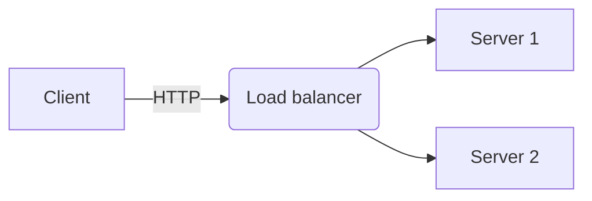

# Authoring guide — writing explainers

This guide is for whoever writes explainer **content**: the built-in writing agent (it is part of its system prompt), another coding agent, or a human. An explainer is a single **MDX file** that this project turns into a polished, interactive, self-contained HTML page.
As an author you only write content. Layout, typography, theming (light/dark), table of contents,
syntax highlighting, math rendering and every interactive widget are already built and tested.
**Never write HTML, CSS, `<script>`, `<style>` or `import` statements** — use Markdown and the components below.

## Workflow

| What | Where / how |
|---|---|
| Your file | `explainers/<slug>/index.mdx` (one folder per explainer, `slug` = kebab-case) |
| Build | `npm run build -- <slug>` → `explainers/<slug>/<slug>.html` (one standalone file) |
| Verify | `npm run check -- <slug>` → opens the page in headless Chromium, reports JS / diagram / chart / math errors and layout problems, saves screenshots to `explainers/<slug>/.check/` |
| Reference | `explainers/showcase/index.mdx` uses every component and is known to render correctly |

An explainer is only done when **build succeeds and check passes with no issues**.

## File format

```mdx
---
title: How Transformers Pay Attention          # required, concise, Title Case
description: One or two sentences shown under the title. Say what the reader will understand by the end.   # required
tags: [machine learning, nlp]                   # optional, 1–4 short tags
level: intermediate                             # optional: beginner | intermediate | advanced
---

<Callout type="tldr">
Three to five sentences that summarise the whole explainer.
</Callout>

## First section
...
```

- Do **not** write an `# H1` heading — the title comes from the frontmatter. Use `##` for sections and `###` for subsections; they build the table of contents.
- `date` and `model` are added automatically.

## How to write a great explainer

1. **Start from the reader.** Open with why the topic matters and a concrete motivating question or example. Then a `tldr` callout.
2. **Intuition before formalism.** Analogy or picture first, then the precise definition, then the math/code.
3. **One idea per section.** Sections of 150–400 words with descriptive headings ("Why gradients vanish", not "Part 2").
4. **Show, don't only tell.** Aim for a visual every 1–2 sections: a diagram for structure/process, a chart for quantities, a `FunctionPlot` for anything with a parameter the reader should play with.
5. **Worked examples** with real numbers. Use `<Callout type="example">`, `<Walkthrough>` or `<Steps>`.
6. **Address misconceptions** explicitly with `<Callout type="warning">`.
7. **Check understanding.** Put 2–4 `<Quiz>` questions near the end of major sections, `<Reveal>` for "think first, then look" prompts, and `<Flashcards>` for key vocabulary at the end.
8. **Applicability.** If the prompt mentions a context ("…and its applicability to Y"), dedicate at least one full section to it, with concrete use cases, limitations and when *not* to use it (`<Columns>` works well for trade-offs).
9. **Finish** with a "Key takeaways" section (short bullet list) and optionally "Going further" (names of papers, books, tools — no fabricated URLs).
10. Length: typically **1,500–3,500 words**. Accuracy beats length: never invent facts, numbers, citations or URLs. If a number is illustrative, say so.
11. **Verify before you write.** Check specific facts (numbers, dates, names, standards, how real systems work) against authoritative sources — official docs, standards, Wikipedia, textbooks, primary papers — and cite them (see *Citations*). If you can't verify something, leave it out or mark it as approximate.
12. Tone: clear, warm, precise. Short paragraphs. Define every term on first use (`<Term>` or `<Definition>`).

## Citations

Cite sources with Markdown footnotes. Put the marker right after the claim, and the definitions at the very end of the file. They are rendered automatically as a numbered **Sources** section (don't write your own "Sources" or "References" heading).

```mdx
An MP3 frame holds 1152 samples per channel[^mp3-spec], split into two granules of 576[^mp3-wiki].

[^mp3-spec]: ISO/IEC 11172-3 (MPEG-1 Audio), via "MP3" — Wikipedia. https://en.wikipedia.org/wiki/MP3
[^mp3-wiki]: "Modified discrete cosine transform" — Wikipedia. https://en.wikipedia.org/wiki/Modified_discrete_cosine_transform
```

- Format: `[^label]: "Page title" — Publisher/Site. URL`. Labels are short and unique; they are numbered automatically in order of appearance.
- Cite specific numbers, dates, quotes, standards and non-obvious claims; common knowledge needs no citation.
- **Only cite URLs that you actually found during research**, copied exactly. Any other URL is rejected by the checker.
- Each footnote definition must be used at least once in the text, and vice versa.
- Ordinary links `[text](url)` are allowed but follow the same rule.

## MDX rules (read carefully — most build failures come from these)

- **Curly braces `{` `}` in normal text are JavaScript expressions.** `A set {1, 2}` silently renders as `2`. Escape them as `\{` and `\}`, put them in `inline code`, or inside math `$...$` (math is safe).
- **`<` followed by a letter starts a JSX tag.** Write `x < 5` (with a space) or `&lt;`. Never write raw HTML like `<br>`, `<div>`, `<sup>`, ``.
- **Leave a blank line** before and after every block component (`<Callout>`, `<Chart …/>`, `<Tabs>`, …) and before/after Markdown inside them.
- Component **props are JavaScript**: strings in quotes `title="..."`, everything else in braces `height={300}`, `items={[{ label: 'A', value: 1 }]}`. Use single quotes inside arrays/objects, or escape double quotes.
- **Prop strings are plain text** — no Markdown, no math inside `question="..."`, `options`, `items`, `cards`. Put rich content in a component's children instead (where supported).
- Self-closing components must end with `/>`. Every opened tag must be closed.
- Math: inline `$...$`, display `$$` on their own lines. Use KaTeX-supported LaTeX only. To write a literal dollar sign use `\$`.
- Code blocks: always give a language (` ```python `). Mermaid diagrams use ` ```mermaid `.
- Don't use `import`/`export` — all components are available automatically.

## Components

### Callout — highlighted aside
```mdx
<Callout type="key" title="Optional custom title">
Markdown content, **bold**, $math$, lists…
</Callout>
```
`type`: `tldr` (summary), `key` (central idea), `info`, `tip`, `warning` (misconception/pitfall), `danger`, `example`, `note`.

### Definition — formal definition of a term
```mdx
<Definition term="Gradient" aka="slope, derivative">
The vector of partial derivatives $\nabla f = (\partial f / \partial x_1, \dots)$.
</Definition>
```

### Term — inline hover tooltip
```mdx
The model uses <Term tip="A vector that represents a token">embeddings</Term> as input.
```

### Mermaid diagrams — structure, processes, sequences, states, timelines
Use a fenced block. Optional caption after the language:
````mdx

````
Supported: `flowchart` (LR/TD), `sequenceDiagram`, `classDiagram`, `stateDiagram-v2`, `erDiagram`, `gantt`, `pie`, `mindmap`, `timeline`, `quadrantChart`, `journey`, `gitGraph`.
Tips: keep diagrams small (≤ 12 nodes); quote labels with special characters `A["f(x) = x²"]`; no Markdown or `$math$` inside labels; don't use `classDef`/`style` colours (theming is automatic); prefer `LR` for pipelines, `TD` for hierarchies.

### Chart — data visualisation (Apache ECharts)
`option` is a standard [ECharts option](https://echarts.apache.org/en/option.html) object. Colours, fonts, tooltip, legend (when >1 named series) and grid are set automatically — omit them.
```mdx
<Chart
  caption="Training loss by epoch"
  height={340}
  option={{
    xAxis: { type: 'category', name: 'Epoch', data: [1, 2, 3, 4, 5] },
    yAxis: { type: 'value', name: 'Loss' },
    series: [
      { name: 'Train', type: 'line', data: [2.1, 1.4, 1.0, 0.8, 0.7] },
      { name: 'Validation', type: 'line', data: [2.2, 1.6, 1.3, 1.2, 1.25] },
    ],
  }}
/>
```
- Types: `line`, `bar` (stack with `stack: 'total'`), `scatter` (data `[[x, y], …]`), `pie` (data `[{ name, value }]`, use `radius: ['45%', '72%']` for a donut), `radar`, `heatmap`, `sankey`, `treemap`, `boxplot`, `funnel`, `gauge`.
- Props: `option` (required, must contain `series`), `height` (px, default 360), `caption`, `wide` (bleeds wider on large screens).
- **No functions** in the option (they cannot be serialised). For formatters use template strings: `axisLabel: { formatter: '{value} %' }`.
- Use real or clearly illustrative data. Label axes with units.

### FunctionPlot — interactive y = f(x) with sliders
The best way to build intuition for any formula with parameters.
```mdx
<FunctionPlot
  fn="A * sin(k * x) * exp(-d * x)"
  params={[
    { name: 'A', label: 'Amplitude', min: 0.5, max: 3, step: 0.1, value: 1 },
    { name: 'k', label: 'Frequency', min: 0.5, max: 5, step: 0.1, value: 2 },
    { name: 'd', label: 'Damping', min: 0, max: 1, step: 0.01, value: 0.2 },
  ]}
  x={[0, 20]}
  y={[-3, 3]}
  xLabel="time (s)"
  yLabel="displacement"
  caption="A damped oscillator. Increase the damping and watch the envelope shrink."
/>
```
- `fn`: a JavaScript expression in `x` and the param names. All `Math` functions/constants work without prefix: `sin`, `cos`, `exp`, `log`, `sqrt`, `abs`, `pow`, `PI`, `E`… `^` is treated as power.
- Several curves: `fn={[{ expr: '1 / (1 + exp(-k*x))', label: 'sigmoid' }, { expr: 'tanh(k*x)', label: 'tanh' }]}`.
- Optional: `params` (each `value` must lie in `[min, max]`; name ≠ `x`), `x` (default `[-10, 10]`), `y` (fixed y range — recommended so the axis doesn't jump), `samples`, `height`, `caption`.

### Stats — headline numbers
```mdx
<Stats items={[
  { label: 'Parameters', value: '175B', desc: 'GPT-3' },
  { label: 'Training tokens', value: '300B' },
]} />
```

### Steps — numbered procedure (static)
Wrap a normal ordered list:
```mdx
<Steps>
1. **Collect data.** Short explanation.
2. **Train the model.** Short explanation.
3. **Evaluate.** Short explanation.
</Steps>
```

### Walkthrough — interactive step-by-step (Next / Back)
Ideal for algorithms, derivations and worked examples where each step builds on the previous.
```mdx
<Walkthrough title="Binary search for 42">
  <Step title="Look at the middle">
    The middle element is **37** < 42, so discard the left half.
  </Step>
  <Step title="Repeat on the right half">
    Markdown, math, code blocks and even charts work inside a step.
  </Step>
</Walkthrough>
```

### Tabs — alternative views of the same thing
```mdx
<Tabs>
  <Tab label="Python">
    ```python
    print("hi")
    ```
  </Tab>
  <Tab label="Intuition">
    Any Markdown or components.
  </Tab>
</Tabs>
```

### Columns — side-by-side comparison
```mdx
<Columns>
  <Column title="Pros" tone="good">
    - Fast
    - Simple
  </Column>
  <Column title="Cons" tone="bad">
    - Memory hungry
  </Column>
</Columns>
```
`cols={3}` for three columns. `tone`: `neutral` (default), `good`, `bad`, `primary`, `secondary`. For many attributes × options, prefer a Markdown table.

### Timeline — history / chronology
```mdx
<Timeline items={[
  { date: '1958', title: 'Perceptron', text: 'Rosenblatt introduces the perceptron.' },
  { date: '1986', title: 'Backpropagation popularised', text: 'Rumelhart, Hinton & Williams.' },
]} />
```

### Quiz — multiple-choice check
```mdx
<Quiz
  question="Which activation function outputs values between 0 and 1?"
  options={['ReLU', 'Sigmoid', 'tanh', 'Linear']}
  answer={1}
>
Sigmoid squashes any input into $(0, 1)$; tanh maps to $(-1, 1)$.
</Quiz>
```
`answer` is the **0-based index** of the correct option (or its exact text). Children (optional) = explanation shown after answering. Make distractors plausible; one unambiguous correct answer.

### Reveal — collapsible "think first" answer
```mdx
<Reveal title="What happens if the learning rate is too large?">
The loss oscillates or diverges because each step overshoots the minimum.
</Reveal>
```

### Flashcards — key vocabulary review (plain text only)
```mdx
<Flashcards cards={[
  { front: 'Epoch', back: 'One full pass over the training data' },
  { front: 'Overfitting', back: 'Fitting noise in the training set; poor generalisation' },
]} />
```

### Plain Markdown
Tables (`| a | b |`), blockquotes (good for a memorable principle or quotation), bullet/numbered lists, `inline code`, **bold**, *italic*, links, footnotes (`[^1]`). Horizontal rules are rarely needed (sections are already separated).

## Choosing visuals

| You want to show… | Use |
|---|---|
| A process, pipeline, architecture, decision logic | Mermaid `flowchart` |
| Messages between actors over time | Mermaid `sequenceDiagram` |
| States and transitions | Mermaid `stateDiagram-v2` |
| A concept map / taxonomy | Mermaid `mindmap` |
| Quantities, trends, comparisons, distributions | `Chart` |
| How a formula reacts to its parameters | `FunctionPlot` |
| A few headline numbers | `Stats` |
| History | `Timeline` |
| An algorithm executed step by step | `Walkthrough` |
| Trade-offs, A vs B | `Columns` or a table |

## Before you finish — checklist

- [ ] Build succeeds and check reports **no issues**; warnings considered.
- [ ] Frontmatter has `title` and `description`; no `# H1` in the body.
- [ ] Starts with motivation + `tldr`; ends with key takeaways.
- [ ] At least 2–3 visuals (diagram / chart / FunctionPlot) that genuinely aid understanding.
- [ ] At least 2 quiz questions; every term defined.
- [ ] Every specific fact, number and name was verified against a source and is cited with a footnote.
