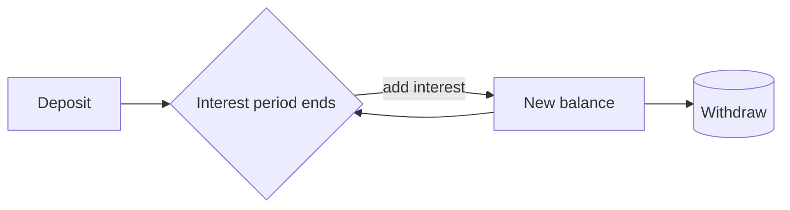
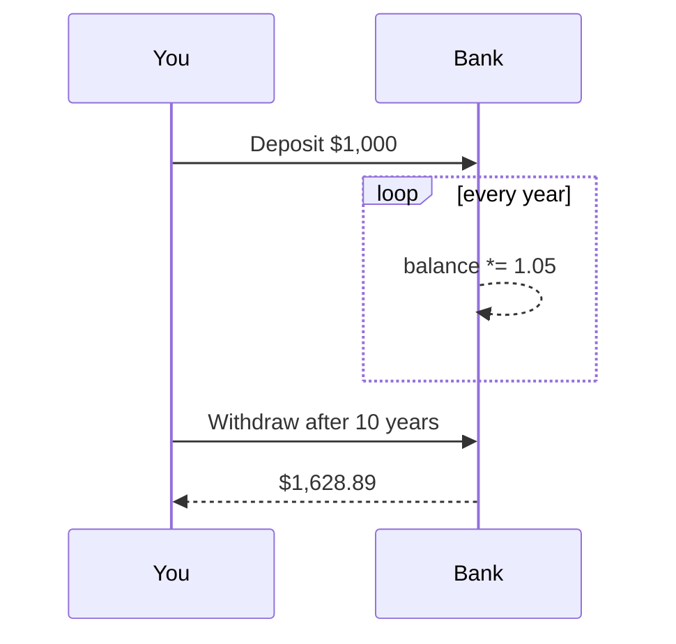

<Callout type="tldr">
This page uses **every component** at least once. If it renders cleanly, explainers can rely on all of them. Run `npm test` to rebuild and check it.
</Callout>

## Text, math and code

Regular Markdown works as you would expect: **bold**, *italic*, `inline code`, [links](https://example.com), and <Term tip="A word whose meaning pops up on hover">tooltips on terms</Term>. Citations use footnotes[^wiki]. Inline math such as $E = mc^2$ or $\sigma(x) = \frac{1}{1 + e^{-x}}$ renders with KaTeX, and so does display math:

$$
\int_{-\infty}^{\infty} e^{-x^2}\,dx = \sqrt{\pi}
$$

> A blockquote works well for a memorable quotation or a principle worth pausing on.

```python
def compound(principal: float, rate: float, years: int) -> float:
    """Value of an investment with yearly compounding."""
    return principal * (1 + rate) ** years
```

| Concept | Symbol | Typical value |
|---|---|---|
| Principal | $P$ | 1,000 |
| Rate | $r$ | 5 % |
| Years | $n$ | 10 |

<Definition term="Compound interest" aka="interest on interest">
Interest computed on the initial principal **and** on all interest accumulated in previous periods: $A = P(1 + r)^n$.
</Definition>

## Callouts

<Callout type="key">The single most important idea of a section goes here.</Callout>
<Callout type="info">Neutral background information.</Callout>
<Callout type="tip" title="Rule of 72">Divide 72 by the interest rate (in %) to estimate the doubling time.</Callout>
<Callout type="warning">
A common misconception or pitfall. Callouts can contain lists:

- nominal vs. effective rates
- fees compound too
</Callout>
<Callout type="danger">Something that can cause real damage.</Callout>
<Callout type="example">A concrete, worked example.</Callout>
<Callout type="note">A side remark.</Callout>

## Diagrams





## Charts

<Chart
  caption="Simple vs. compound growth of $1,000 at 5 %"
  option={{
    xAxis: { type: 'category', name: 'Year', data: [0, 5, 10, 15, 20, 25, 30] },
    yAxis: { type: 'value', name: 'Balance ($)' },
    series: [
      { name: 'Simple', type: 'line', data: [1000, 1250, 1500, 1750, 2000, 2250, 2500] },
      { name: 'Compound', type: 'line', data: [1000, 1276, 1629, 2079, 2653, 3386, 4322] },
    ],
  }}
/>

<Chart
  height={300}
  caption="Where the final balance comes from"
  option={{
    series: [{ type: 'pie', radius: ['45%', '72%'], data: [
      { name: 'Principal', value: 1000 },
      { name: 'Simple interest', value: 1500 },
      { name: 'Interest on interest', value: 1822 },
    ] }],
  }}
/>

<FunctionPlot
  fn={[{ expr: 'P * (1 + r/100) ** x', label: 'compound' }, { expr: 'P * (1 + r/100 * x)', label: 'simple' }]}
  params={[
    { name: 'r', label: 'Interest rate %', min: 0, max: 15, step: 0.5, value: 5 },
    { name: 'P', label: 'Principal', min: 100, max: 5000, step: 100, value: 1000 },
  ]}
  x={[0, 40]}
  xLabel="years"
  yLabel="balance"
  caption="Drag the sliders to see how rate and principal change the curves"
/>

<Stats items={[
  { label: 'Doubling time at 5 %', value: '14.2 y', desc: 'Rule of 72 says 14.4' },
  { label: 'After 30 years', value: '4.3×', desc: 'vs. 2.5× with simple interest' },
  { label: 'Rate needed to double in 10 y', value: '7.2 %' },
  { label: 'Continuous compounding, 10 y', value: '$1,648.72', desc: '1000 · e^0.5' },
]} />

## Structure

<Steps>
1. **Pick a rate.** Use the effective annual rate, not the nominal one.
2. **Pick a horizon.** Longer horizons make compounding dominate.
3. **Apply the formula.** $A = P(1+r)^n$.
</Steps>

<Columns>
  <Column title="Simple interest" tone="secondary">
    Grows **linearly**. Interest is always computed on the original principal.
  </Column>
  <Column title="Compound interest" tone="primary">
    Grows **exponentially**. Interest itself earns interest.

    - Rewards patience
    - Punishes debt
  </Column>
</Columns>

<Tabs>
  <Tab label="Python">
    ```python
    balance = 1000 * 1.05 ** 10
    ```
  </Tab>
  <Tab label="JavaScript">
    ```js
    const balance = 1000 * 1.05 ** 10;
    ```
  </Tab>
  <Tab label="Chart">
    <Chart height={240} option={{ xAxis: { type: 'category', data: ['A', 'B', 'C'] }, yAxis: { type: 'value' }, series: [{ type: 'bar', data: [3, 7, 5] }] }} />
  </Tab>
</Tabs>

<Timeline items={[
  { date: '1202', title: 'Fibonacci’s Liber Abaci', text: 'Includes early compound interest problems.' },
  { date: '1683', title: 'Bernoulli discovers e', text: 'Studying continuous compounding leads to the constant e.' },
  { date: '1748', title: 'Euler names e', text: 'Euler publishes its properties in Introductio.' },
]} />

<Walkthrough title="Walkthrough">
  <Step title="Start with $1,000">
    You deposit **$1,000** at 5 % per year.
  </Step>
  <Step title="Year one">
    Interest is $1000 \times 0.05 = 50$, so the balance is **$1,050**.
  </Step>
  <Step title="Year two">
    Interest is now computed on $1,050: $1050 \times 0.05 = 52.50$. That extra $2.50 is interest on interest.
  </Step>
</Walkthrough>

## Learning checks

<Quiz
  question="At 6 % per year, roughly how long does it take to double your money?"
  options={['6 years', '12 years', '20 years', '72 years']}
  answer={1}
>
By the rule of 72: $72 / 6 = 12$ years.
</Quiz>

<Reveal title="Why does compounding beat simple interest?">
Because each period's interest is added to the base on which the next period's interest is computed, so growth is proportional to the current balance — the definition of exponential growth.
</Reveal>

<Flashcards cards={[
  { front: 'Compound interest formula', back: 'A = P(1 + r)^n' },
  { front: 'Rule of 72', back: 'Doubling time ≈ 72 / rate (%)' },
  { front: 'Continuous compounding', back: 'A = P·e^(rt)' },
]} />

[^wiki]: "Compound interest" — Wikipedia. https://en.wikipedia.org/wiki/Compound_interest
